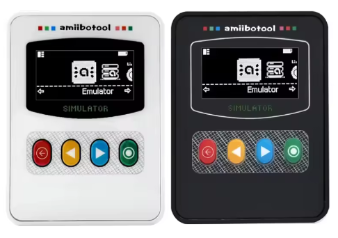

# Pixl.js for Amiibotool/Evergenesis/nfctool

This repo is a forked version of the Pixl.js firmware by solosky, adapted for 4-button OLED devices such as the Amiibotool, Evergenesis, and nfctool.

## Features

**Device**
* OLED screen flipped 180 degrees, with back-button navigation throughout
* English only, with new menu icons and faster list scrolling
* Factory Reset in Settings: erases all amiibo, cards, and settings but keeps key_retail.bin

**Amiibo Emulator**
* Opens straight into your amiibo folder
* Amiibo Info: nickname, Mii owner, game, write count, and dates
* Reset Amiibo: clears user and game data so the figure can be set up again
* Full support for 2048-byte amiibo, including Set Custom ID and Random Tag

**Amiibo Database**
* 20 newer amiibo added
* Sort By: Name or Popularity

**Stability**
* Fixes for crashes in large folders and freezes during repeated scans
* Recovers from a damaged settings file
* Lower memory use for more headroom

## Images

## Updating Firmware

* [https://thegecko.github.io/web-bluetooth-dfu/examples/web.html](https://thegecko.github.io/web-bluetooth-dfu/examples/web.html)

1) **Browser check first:** This website needs Web Bluetooth. Use Chrome or Edge (Firefox and Safari won't work) and make sure the laptop's Bluetooth is on.
2) **Load the package:** Drag the firmware .zip file onto "Choose a firmware package," or click it and select the file. Load the zip before selecting the device — the tool reads the manifest.json inside to know what it's flashing.
3) **Put the device in DFU mode:** On the device, Settings → Firmware Update. It reboots and starts advertising as a DFU target.
4) **Click "Select Device":** Chrome opens its Bluetooth chooser. Pick the DFU device (look for a name like "pixl dfu"). The transfer starts automatically and you'll see progress; the device reboots into the new firmware when it completes.
