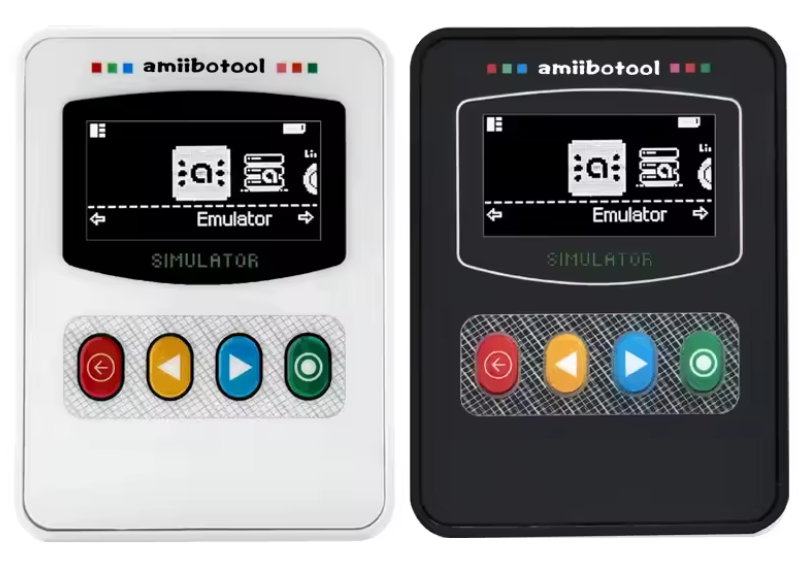

# Pixl.js for Amiibotool/Evergenesis/nfctool

This repo is a forked version of the Pixl.js firmware by solosky, adapted for 4-button OLED devices such as the Amiibotool, Evergenesis, and nfctool.

## Images

## Updating from pixl.js 2.16.0 or 2.16.0-rks

This firmware uses a new storage layout, so the first boot formats the card and **everything on it is deleted, including key_retail.bin**. Before updating:

1. **Back up key_retail.bin** and your amiibo. On pixl.js 2.16.0 or 2.16.0-rks, download them from the pixl.js File Transfer website (https://pixl.amiibo.xyz). Without the key, the device can't decrypt or write amiibo, and this firmware does not include it.
2. Flash this firmware (see Updating Firmware below) and let it boot once. Settings → Storage should show the card nearly empty.
3. Upload key_retail.bin and your amiibo again with the File Transfer website.

To go back to pixl.js 2.16.0 or 2.16.0-rks, format the card from the File Transfer website while still on this firmware, then flash the older firmware. Older firmware can't read files written by this one.

## Features

**Device**
* OLED screen flipped 180 degrees, with back-button navigation throughout
* English only, with new menu icons and faster list scrolling
* Factory Reset in Settings: erases all amiibo, cards, and settings but keeps key_retail.bin
* **NEW: File paths up to 96 bytes (was 63), so deeper and longer folder names fit; names stay at 47 bytes.**

**Amiibo Emulator**
* Opens straight into your amiibo folder
* Amiibo Info: nickname, Mii owner, game, write count, and dates
* Reset Amiibo: clears user and game data so the figure can be set up again
* Full support for 2048-byte amiibo, including Set Custom ID and Random Tag

**Amiibo Database**
* Database refreshed from amiiboapi.org, with 22 newer amiibo added
* Sort By: Name or Popularity

**Stability**
* Fixes for crashes in large folders and freezes during repeated scans
* Recovers from a damaged settings file
* Lower memory use for more headroom

## File Transfer

* Works with the pixl.js website (https://pixl.amiibo.xyz) and the Amiibotool website (https://rockyseltzer.github.io/amiibotool/)
* Only the Amiibotool website (https://rockyseltzer.github.io/amiibotool/) has the unlocked 96-byte limit; the pixl.js website still applies its own 63-byte limit
* Paths over the limit are rejected instead of being saved under a cut-off name

## Updating Firmware

* [https://thegecko.github.io/web-bluetooth-dfu/examples/web.html](https://thegecko.github.io/web-bluetooth-dfu/examples/web.html)

1) **Browser check first:** This website needs Web Bluetooth. Use Chrome or Edge (Firefox and Safari won't work) and make sure the laptop's Bluetooth is on.
2) **Load the package:** Drag the firmware .zip file onto "Choose a firmware package," or click it and select the file. Load the zip before selecting the device — the tool reads the manifest.json inside to know what it's flashing.
3) **Put the device in DFU mode:** On the device, Settings → Firmware Update. It reboots and starts advertising as a DFU target.
4) **Click "Select Device":** Chrome opens its Bluetooth chooser. Pick the DFU device (look for a name like "pixl dfu"). The transfer starts automatically and you'll see progress; the device reboots into the new firmware when it completes.
